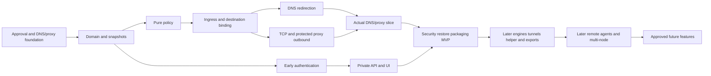

# Dependency map

Status: P0-01 through P0-05 and P1-01 through P1-04/P1-07 complete; P1-05 Ed25519 qualification in progress; real fork test deferred. Edges are planned prerequisites, not implemented crate dependencies.

## Current release chain

P0 contracts/DNS-proxy lab/inventory → P1 Profiles/Endpoints/storage/secrets/snapshots → P2 catalogs/layered policy → P3 legacy + personal secure DNS and P4 separate gateway grants/origin/TCP/proxy → P4-08 real DNS/proxy slice → P6/P7 administration → P10/P11 security/recovery/install → P7-07/P11-06 MVP.

Authentication and security begin early. No MVP task depends on P5 or P10-01, directly or transitively. G3 protocols/helper start after P11-06; G4 agents/groups follow P5-10.

## Workstream flow

## Exact task dependencies

| Task | Delivery | Prerequisites |
|---|---|---|
| P0-01 | MVP | Roadmap approval |
| P0-02 | MVP | P0-01 |
| P0-03 | MVP | P0-01 |
| P0-04 | MVP | P0-02 |
| P0-05 | MVP | P0-01 |
| P1-01 | MVP | P0-02 |
| P1-02 | MVP | P1-01 |
| P1-03 | MVP | P1-02 |
| P1-04 | MVP | P1-03 |
| P1-05 | MVP | P1-04, P1-07 |
| P1-06 | MVP | P1-05 |
| P1-07 | MVP | P1-01 |
| P2-01 | MVP | P1-02 |
| P2-02 | MVP | P2-01, P1-01 |
| P2-03 | MVP | P2-02 |
| P2-04 | MVP | P2-03 |
| P2-05 | MVP | P2-04, P1-05, P2-07 |
| P2-06 | MVP | P2-05 |
| P2-07 | MVP | P1-02, P0-05 |
| P3-01 | MVP | P0-03, P2-05 |
| P3-02 | MVP | P3-01 |
| P3-03 | MVP | P3-02 |
| P3-04 | MVP | P3-03 |
| P3-05 | MVP | P3-04 |
| P3-06 | MVP | P3-05, P4-01 |
| P3-07 | MVP | P3-06, P6-01 |
| P4-01 | MVP | P2-05, P0-01 |
| P4-02 | MVP | P4-01 |
| P4-03 | MVP | P4-01 |
| P4-04 | MVP | P4-02, P4-03 |
| P4-05 | MVP | P4-04, P1-07, P0-05 |
| P4-06 | MVP | P4-05, P2-04 |
| P4-07 | MVP | P4-06 |
| P4-08 | MVP | P3-06, P4-07, P10-02, P3-07 |
| P5-01 | POST_MVP_PROTOCOLS | P1-02, P0-05, P11-06 |
| P5-02 | POST_MVP_PROTOCOLS | P5-01, P1-06, P1-07 |
| P5-03 | POST_MVP_PROTOCOLS | P5-02, P10-01 |
| P5-04 | POST_MVP_PROTOCOLS | P5-03, P3-06, P4-07 |
| P5-05 | POST_MVP_PROTOCOLS | P5-04, P0-05 |
| P5-06 | POST_MVP_PROTOCOLS | P5-04, P0-05 |
| P5-07 | POST_MVP_PROTOCOLS | P5-05, P5-06 |
| P5-08 | POST_MVP_PROTOCOLS | P5-07 |
| P5-09 | POST_MVP_PROTOCOLS | P5-08, P7-02, P7-04 |
| P5-10 | POST_MVP_PROTOCOLS | P5-08, P5-09, P10-01, P11-06 |
| P6-01 | MVP | P1-03, P1-07 |
| P6-02 | MVP | P6-01, P2-06 |
| P6-03 | MVP | P6-02, P1-04 |
| P6-04 | MVP | P6-03, P2-06 |
| P6-05 | MVP | P6-04, P1-06 |
| P6-06 | MVP | P6-02, P3-07, P4-07 |
| P6-07 | MVP | P6-05, P1-07 |
| P6-08 | MVP | P6-01, P6-05 |
| P7-01 | MVP | P6-02 |
| P7-02 | MVP | P7-01, P6-03 |
| P7-03 | MVP | P7-01, P6-05 |
| P7-04 | MVP | P7-02, P3-07, P4-08 |
| P7-05 | MVP | P7-01, P6-06 |
| P7-06 | MVP | P7-03, P6-07, P6-08 |
| P7-07 | MVP | P7-04, P7-05, P7-06, P4-08, P10-07, P11-01, P11-03 |
| P8-01 | POST_MVP_MULTI_NODE | P6-01, P1-05, P5-10 |
| P8-02 | POST_MVP_MULTI_NODE | P8-01, P5-08 |
| P8-03 | POST_MVP_MULTI_NODE | P8-02, P6-05 |
| P8-04 | POST_MVP_MULTI_NODE | P8-03, P1-06 |
| P8-05 | POST_MVP_MULTI_NODE | P8-04, P1-07 |
| P8-06 | POST_MVP_MULTI_NODE | P8-05, P10-01 |
| P9-01 | POST_MVP_MULTI_NODE | P8-06, P6-02 |
| P9-02 | POST_MVP_MULTI_NODE | P9-01, P4-06 |
| P9-03 | POST_MVP_MULTI_NODE | P9-02, P5-06 |
| P9-04 | POST_MVP_MULTI_NODE | P9-03, P8-03 |
| P9-05 | POST_MVP_MULTI_NODE | P9-04 |
| P10-01 | POST_MVP_PROTOCOLS | P0-03, P1-02, P1-07, P11-06 |
| P10-02 | MVP | P6-08, P0-03 |
| P10-03 | MVP | P3-05, P4-03, P1-02 |
| P10-04 | MVP | P3-06, P4-06, P1-06 |
| P10-05 | MVP | P4-08, P10-02, P10-03 |
| P10-06 | MVP | P6-07, P1-06, P10-05 |
| P10-07 | MVP | P10-04, P10-06 |
| P11-01 | MVP | P4-08, P6-07, P10-02 |
| P11-02 | MVP | P11-01 |
| P11-03 | MVP | P11-01, P10-06 |
| P11-04 | MVP | P11-01, P7-06 |
| P11-05 | MVP | P11-03, P0-05, P10-07 |
| P11-06 | MVP | P0-04, P7-07, P11-02, P11-04, P11-05 |
| F-01 | FUTURE | P9-05 |
| F-02 | FUTURE | P9-05 |
| F-03 | FUTURE | P11-06 |
| F-04 | FUTURE | P11-06 |
| F-05 | FUTURE | P9-05 |

## Computed longest MVP prerequisite chain

P0-01 → P0-02 → P1-01 → P1-02 → P2-01 → P2-02 → P2-03 → P2-04 → P2-05 → P2-06 → P6-02 → P6-03 → P6-04 → P6-05 → P6-08 → P10-02 → P4-08 → P10-05 → P10-06 → P10-07 → P7-07 → P11-06

## Computed longest full-plan prerequisite chain

P0-01 → P0-02 → P1-01 → P1-02 → P2-01 → P2-02 → P2-03 → P2-04 → P2-05 → P2-06 → P6-02 → P6-03 → P6-04 → P6-05 → P6-08 → P10-02 → P4-08 → P10-05 → P10-06 → P10-07 → P7-07 → P11-06 → P5-01 → P5-02 → P5-03 → P5-04 → P5-05 → P5-07 → P5-08 → P5-09 → P5-10 → P8-01 → P8-02 → P8-03 → P8-04 → P8-05 → P8-06 → P9-01 → P9-02 → P9-03 → P9-04 → P9-05 → F-01

These count tasks, not elapsed time. Stable workstream numbering does not dictate execution order.

External MVP dependencies: supported Linux target, restricted ingress binding, protected proxy/reference services, CodeScene baseline and GitHub/Codecov activation. None implies a completed product test. Engines/clients/kernel bridges are G3 evidence, not MVP prerequisites.
